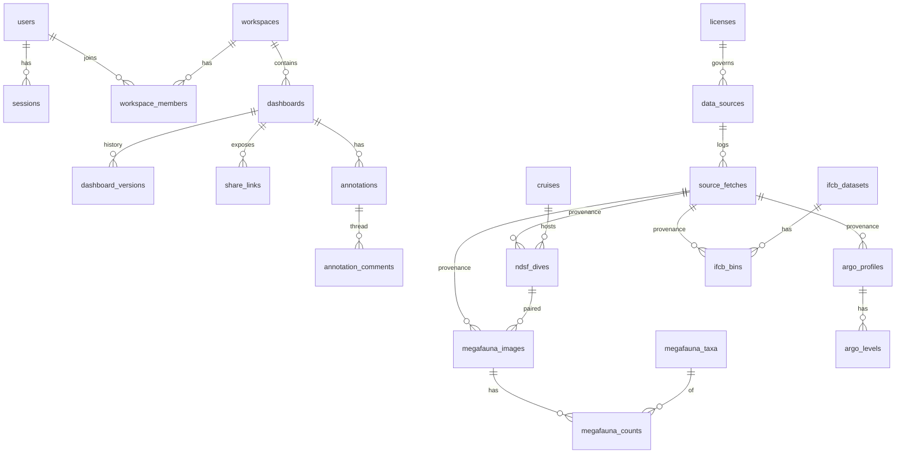

# Data Model (Postgres 16 + PostGIS)

Conventions: `uuid` primary keys for app-owned rows, natural keys for cached upstream rows, `timestamptz` everywhere, `geography(Point,4326)` for positions, `jsonb raw` to keep the upstream record verbatim. Every cache table has `source_id` and `fetch_id` so the UI can display the access date and citation (see DESIGN.md §8).



## 1. Accounts and collaboration

```sql
create extension if not exists postgis;
create extension if not exists citext;

create table users (
  id            uuid primary key default gen_random_uuid(),
  email         citext unique not null,
  display_name  text not null,
  password_hash text,                      -- null for OAuth-only accounts
  orcid         text unique,
  is_admin      boolean not null default false,
  email_verified_at timestamptz,
  created_at    timestamptz not null default now(),
  last_login_at timestamptz
);

create table sessions (
  id          uuid primary key default gen_random_uuid(),
  user_id     uuid not null references users(id) on delete cascade,
  token_hash  bytea unique not null,
  expires_at  timestamptz not null,
  user_agent  text, ip inet,
  created_at  timestamptz not null default now()
);

create table oauth_accounts (
  provider            text not null,          -- 'orcid'
  provider_account_id text not null,
  user_id             uuid not null references users(id) on delete cascade,
  primary key (provider, provider_account_id)
);

create table workspaces (
  id          uuid primary key default gen_random_uuid(),
  slug        text unique not null,
  name        text not null,
  owner_id    uuid not null references users(id),
  visibility  text not null default 'private' check (visibility in ('private','link','public')),
  created_at  timestamptz not null default now()
);

create table workspace_members (
  workspace_id uuid references workspaces(id) on delete cascade,
  user_id      uuid references users(id) on delete cascade,
  role         text not null check (role in ('owner','editor','viewer')),
  invited_by   uuid references users(id),
  created_at   timestamptz not null default now(),
  primary key (workspace_id, user_id)
);

create table dashboards (
  id           uuid primary key default gen_random_uuid(),
  workspace_id uuid not null references workspaces(id) on delete cascade,
  name         text not null,
  kind         text not null check (kind in ('argo','dives','megafauna','ifcb','satellite','custom')),
  state        jsonb not null,               -- see DESIGN.md §3
  version      integer not null default 1,   -- optimistic concurrency
  created_by   uuid not null references users(id),
  created_at   timestamptz not null default now(),
  updated_at   timestamptz not null default now()
);

create table dashboard_versions (
  dashboard_id uuid references dashboards(id) on delete cascade,
  version      integer not null,
  state        jsonb not null,
  author_id    uuid references users(id),
  message      text,
  created_at   timestamptz not null default now(),
  primary key (dashboard_id, version)
);

create table share_links (
  id           uuid primary key default gen_random_uuid(),
  slug         text unique not null,          -- 8–10 char base62
  dashboard_id uuid not null references dashboards(id) on delete cascade,
  mode         text not null check (mode in ('live','snapshot')),
  snapshot     jsonb,                          -- state + provenance frozen at creation (mode = snapshot)
  created_by   uuid not null references users(id),
  expires_at   timestamptz,
  revoked_at   timestamptz,
  view_count   integer not null default 0,
  created_at   timestamptz not null default now()
);

create table annotations (
  id            uuid primary key default gen_random_uuid(),
  dashboard_id  uuid not null references dashboards(id) on delete cascade,
  author_id     uuid not null references users(id),
  geom          geography(Point,4326),         -- optional map anchor
  time_ref      tstzrange,                     -- optional time anchor
  target_type   text check (target_type in ('argo_profile','ndsf_dive','megafauna_image','ifcb_bin','satellite_layer','free')),
  target_id     text,                          -- e.g. dive_uid, profile id, File_Name, bin pid, layer id + date
  body          text not null,
  resolved_at   timestamptz,
  created_at    timestamptz not null default now(),
  updated_at    timestamptz not null default now()
);
create index on annotations using gist (geom);

create table annotation_comments (
  id            uuid primary key default gen_random_uuid(),
  annotation_id uuid not null references annotations(id) on delete cascade,
  author_id     uuid not null references users(id),
  body          text not null,
  created_at    timestamptz not null default now()
);

create table activity_events (
  id           bigserial primary key,
  workspace_id uuid not null references workspaces(id) on delete cascade,
  actor_id     uuid references users(id),
  type         text not null,                 -- dashboard.saved, annotation.created, member.added, share.created ...
  payload      jsonb not null default '{}',
  created_at   timestamptz not null default now()
);
create index on activity_events (workspace_id, created_at desc);
```

## 2. Provenance and licensing

```sql
create table licenses (
  id                   text primary key,      -- 'CC-BY-4.0', 'CC-BY-NC-SA-3.0-US', 'CC-BY-NC-SA-4.0', 'CC0-1.0', 'US-GOV-PUBLIC-DOMAIN', 'UNSTATED'
  name                 text not null,
  url                  text,
  attribution_required boolean not null,
  non_commercial_only  boolean not null,
  share_alike          boolean not null,
  allows_redistribution boolean not null
);

create table data_sources (
  id                 text primary key,        -- 'argo_ifremer_erddap', 'argovis', 'ndsf_dives_wfs', 'ndsf_alvin_ops_xlsx', 'ndsf_jason_ops_xlsx', 'r2r', 'bcodmo_932975', 'ifcb_whoi', 'nasa_gibs', 'coastwatch_erddap'
  name               text not null,
  provider           text not null,
  homepage_url       text not null,
  terms_url          text,
  license_id         text not null references licenses(id),
  doi                text,
  citation_text      text not null,           -- exact text shown in the UI
  acknowledgement    text,                    -- required acknowledgement statement, if any
  images_hotlink_only boolean not null default false,
  refresh_interval   interval,                -- null = on-demand only
  max_age            interval,                -- stale badge threshold
  notes              text
);

create table source_fetches (
  id            bigserial primary key,
  source_id     text not null references data_sources(id),
  request_url   text not null,
  params        jsonb,
  requested_at  timestamptz not null default now(),
  completed_at  timestamptz,
  status        text not null check (status in ('running','ok','error')),
  http_status   integer,
  bytes         bigint,
  record_count  integer,
  etag          text,
  error         text
);
create index on source_fetches (source_id, completed_at desc);
```

Helper view used by the API to fill `provenance[]`:

```sql
create view v_source_status as
select s.id, s.name, s.citation_text, s.doi, l.id as license_id, l.url as license_url,
       max(f.completed_at) filter (where f.status = 'ok') as last_success_at,
       max(f.completed_at) as last_attempt_at
from data_sources s
join licenses l on l.id = s.license_id
left join source_fetches f on f.source_id = s.id
group by s.id, l.id;
```

## 3. Argo

```sql
create table argo_floats (
  platform_number text primary key,
  project_name    text, pi_name text, platform_type text, float_serial_no text,
  first_seen      timestamptz, last_seen timestamptz,
  source_id       text not null references data_sources(id),
  fetch_id        bigint references source_fetches(id)
);

create table argo_profiles (
  id              text primary key,           -- '<platform_number>_<cycle_number><direction>' e.g. '7902283_083'
  platform_number text not null references argo_floats(platform_number),
  cycle_number    integer not null,
  direction       char(1),
  time            timestamptz not null,
  geom            geography(Point,4326) not null,
  data_mode       char(1),                    -- R / A / D
  has_bgc         boolean not null default false,
  n_levels        integer,
  levels_fetched_at timestamptz,              -- null until levels are pulled on demand
  source_id       text not null references data_sources(id),
  fetch_id        bigint references source_fetches(id),
  raw             jsonb
);
create index on argo_profiles using gist (geom);
create index on argo_profiles (time desc);
create index on argo_profiles (platform_number, cycle_number);

create table argo_levels (                    -- populated on demand, TTL-evicted
  profile_id     text references argo_profiles(id) on delete cascade,
  level          integer,
  pres real, temp real, psal real, doxy real, chla real, nitrate real,
  pres_qc char(1), temp_qc char(1), psal_qc char(1), doxy_qc char(1),
  pres_adjusted real, temp_adjusted real, psal_adjusted real,
  primary key (profile_id, level)
);
```

## 4. Deep submergence (NDSF / R2R)

```sql
create table cruises (
  cruise_id        text primary key,          -- 'AT42-21', 'RR2102'
  r2r_doi          text,
  vessel_name      text,
  cruise_name      text,
  chief_scientist  text,
  depart_date date, depart_port text, arrive_date date, arrive_port text,
  operator_name    text,
  source_id        text not null references data_sources(id),
  fetch_id         bigint references source_fetches(id),
  raw              jsonb
);

create table ndsf_dives (
  dive_uid         text primary key,          -- WFS dive_uid, e.g. '16936'
  dive_id          text not null,             -- '5044', 'J2-1309', 'sentry313'
  vehicle          text not null,             -- ALVIN, JASON, JASON2, SENTRY, ...
  vehicle_type     text,                      -- HOV / ROV / AUV
  current_ndsf_vehicle boolean,
  cruise_id        text references cruises(cruise_id),
  cruise_uid       text,
  ship             text,
  dsl_ops_id       text,
  dive_start       timestamptz,
  dive_end         timestamptz,
  data_start timestamptz, data_end timestamptz,
  geom             geography(Point,4326),
  max_depth_m      numeric,                   -- stored positive
  dive_feature     text, cruise_feature text, all_features text,
  chief_scientists jsonb,                     -- [{name, affiliation}]
  observers        jsonb,                     -- [{obs1, obs2, pilot}]
  pilot            text,
  devices          text, comments text,
  framegrab_url    text,                      -- Sealog replay (link-out only)
  has_framegrabs   boolean,
  mgds_event_url   text,
  data_at_mgds     boolean,
  source_id        text not null references data_sources(id),
  fetch_id         bigint references source_fetches(id),
  raw              jsonb
);
create unique index on ndsf_dives (vehicle, dive_id);
create index on ndsf_dives using gist (geom);
create index on ndsf_dives (cruise_id);
create index on ndsf_dives (dive_start);

-- Enrichment from the NDSF operations spreadsheets (Alvin dive log; DSL ops summaries "All Lowerings").
create table ndsf_dive_ops (
  dive_uid        text primary key references ndsf_dives(dive_uid) on delete cascade,
  purpose         text, sponsor text,          -- Alvin
  launch_time time, time_submerged interval, recovery_time time, bottom_time interval,
  observed        text, sampled text, remarks text,
  min_depth_m numeric, max_depth_m numeric, coverage_nmi numeric,  -- Jason
  work_area       text,
  source_id       text not null references data_sources(id),
  fetch_id        bigint references source_fetches(id),
  raw             jsonb
);
```

## 5. EPR megafauna (BCO-DMO 932975)

```sql
create table megafauna_images (
  file_name        text primary key,          -- 'D5044_OIS_down_12252019_195010'
  site             text not null,             -- Lucky's Mound | Oceanic Rise | Sentry Spire
  habitat          text,
  event_date       date not null,
  geom             geography(Point,4326) not null,
  depth_m          numeric,
  vehicle_altitude_m numeric,
  angle_category   text,
  adjustment_value numeric,
  useable_proportion numeric,
  corrected_area_m2 numeric,
  vehicle          text,                      -- derived: ALVIN | JASON2
  dive_id          text,                      -- derived: '5044' | 'J2-1309' | 'J2-1311'
  dive_uid         text references ndsf_dives(dive_uid),   -- paired
  cruise_id        text references cruises(cruise_id),
  source_id        text not null references data_sources(id),
  fetch_id         bigint references source_fetches(id)
);
create index on megafauna_images using gist (geom);

create table megafauna_taxa (
  id                      serial primary key,
  verbatim_identification text unique not null,
  worms_scientific_name   text,
  worms_lsid              text,               -- WoRMS_scientificNameID
  feeding_mode            text,
  cropped_image_path      text                -- from the CC-BY supplemental ZIP, served by the API
);

create table megafauna_counts (
  file_name        text references megafauna_images(file_name) on delete cascade,
  taxon_id         integer references megafauna_taxa(id),
  individual_count integer not null,
  primary key (file_name, taxon_id)
);
```

## 6. IFCB

```sql
create table ifcb_datasets (
  name             text primary key,          -- 'mvco'
  title            text,
  dashboard_base_url text not null,           -- https://ifcb-data.whoi.edu
  doi              text,                      -- 10.26025/9q7z-a148 for mvco
  time_start timestamptz, time_end timestamptz,
  source_id        text not null references data_sources(id),
  fetch_id         bigint references source_fetches(id)
);

create table ifcb_timeseries (
  dataset     text references ifcb_datasets(name) on delete cascade,
  metric      text not null,                  -- temperature | humidity | concentration | n_images | ml_analyzed | ...
  resolution  text not null,                  -- day | week | month
  t           timestamptz not null,
  value       double precision,
  fetch_id    bigint references source_fetches(id),
  primary key (dataset, metric, resolution, t)
);

create table ifcb_bins (                      -- on-demand cache of /api/bin/{pid}
  pid              text primary key,          -- 'D20260717T223900_IFCB102'
  dataset          text references ifcb_datasets(name),
  sample_time      timestamptz not null,
  geom             geography(Point,4326),
  depth_m          numeric,
  instrument       text,
  num_triggers integer, num_images integer,
  ml_analyzed      numeric,
  concentration    numeric,
  has_blobs boolean, has_features boolean, has_class_scores boolean,
  previous_pid text, next_pid text,
  fetch_id         bigint references source_fetches(id),
  raw              jsonb
);
create index on ifcb_bins (dataset, sample_time);
-- ROI images are never stored (license unstated); the API proxies them with short cache headers.
```

## 7. Satellite

```sql
create table satellite_layers (
  id              text primary key,           -- 'gibs:GHRSST_L4_MUR_Sea_Surface_Temperature'
  provider        text not null,              -- gibs | erddap
  title           text not null,
  variable        text, units text,
  wmts_template   text,                       -- https://gibs.earthdata.nasa.gov/wmts/epsg3857/best/{layer}/default/{time}/{tms}/{z}/{y}/{x}.{ext}
  tile_matrix_set text, image_format text,
  erddap_dataset_id text, erddap_variable text,   -- for point time series
  legend_url      text,
  time_start date, time_end date, period text,   -- from DescribeDomains
  time_gaps       jsonb,                      -- [[start,end], ...] unavailable ranges
  source_id       text not null references data_sources(id),
  fetch_id        bigint references source_fetches(id)
);

create table satellite_point_samples (         -- cache of griddap point queries
  layer_id   text references satellite_layers(id) on delete cascade,
  geom       geography(Point,4326) not null,
  t          timestamptz not null,
  value      double precision,
  fetch_id   bigint references source_fetches(id),
  primary key (layer_id, geom, t)
);
```

## 8. Retention and refresh

| Table | Refresh | Retention |
|---|---|---|
| `ndsf_dives`, `ndsf_dive_ops`, `cruises` | weekly full refresh | keep latest |
| `argo_profiles` | every 6 h for the trailing 30 days; older windows on demand | 1 year index; `argo_levels` evicted after 30 days unused |
| `megafauna_*` | monthly (dataset is static) | keep |
| `ifcb_datasets`, `ifcb_timeseries` | daily | keep |
| `ifcb_bins` | on demand | 90 days unused |
| `satellite_layers` | daily DescribeDomains | keep |
| `satellite_point_samples` | on demand | 180 days |
