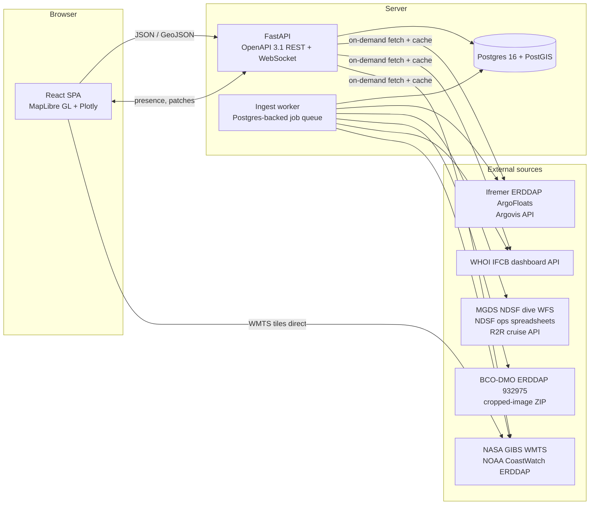

# Ocean App — System Design

Source of truth for the product and architecture described in the
"ULTIMATE OCEAN APP Specifications" document. Companion docs:

| Doc | Purpose |
|---|---|
| [DATA_SOURCES.md](DATA_SOURCES.md) | Every external dataset: verified endpoints, formats, license, citation, caching policy |
| [DATA_MODEL.md](DATA_MODEL.md) | Postgres/PostGIS schema |
| [API.md](API.md) | OpenAPI REST surface and conventions |
| [ROADMAP.md](ROADMAP.md) | Epics and delivery phases (mirrors GitHub issues) |

## 1. Requirements (from the spec)

| # | Requirement | Design response |
|---|---|---|
| R1 | Interactive map of Argo float data | Argo dashboard (§4.1) fed by Ifremer ERDDAP / Argovis |
| R2 | Dive data from Jason and Alvin | Deep Submergence dashboard (§4.2) fed by the NDSF dive-metadata WFS at MGDS, NDSF operations spreadsheets, R2R cruise API |
| R3 | BCO-DMO megafauna dataset 932975, paired with dive metadata and images | EPR Megafauna dashboard (§4.3); images are AT42-21 Alvin dive 5044 and RR2102 Jason dives J2-1309/J2-1311, paired by dive id to R2 data and to the Sealog framegrab replay |
| R4 | IFCB data from the IFCB dashboard | IFCB Plankton dashboard (§4.4) fed by the WHOI IFCB dashboard JSON API |
| R5 | Satellite data of the ocean surface | Satellite dashboard (§4.5) fed by NASA GIBS WMTS tiles and NOAA CoastWatch ERDDAP grids |
| R6 | Divide into different dashboards | Dashboard model (§3) with five built-in kinds plus custom composites |
| R7 | User logins | Accounts, sessions, roles (§5) |
| R8 | Interactive collaboration | Workspaces, live presence/state sync, annotations, comments, version history (§6) |
| R9 | Shareable links | URL-encoded view state plus server-side short links, live or snapshot (§7) |
| R10 | Never fabricate data when a source is unavailable | Hard rule (§8): no synthetic fixtures on any production path; explicit "source unavailable" states |
| R11 | Documentation of the visualization/exploration tools | In-app help per dashboard, user guide, API docs (§9) |
| R12 | Credit data authors, cite sources, show access dates for cached data, comply with licenses | Provenance framework (§8): every response carries citations and `fetched_at`; per-source license rules enforced in code |
| R13 | React frontend, Postgres backend, OpenAPI REST API | §2 |

## 2. Architecture



### 2.1 Tech stack

| Layer | Choice | Why |
|---|---|---|
| Frontend | React 18 + TypeScript + Vite; TanStack Query; MapLibre GL JS; Plotly.js (lazy-loaded); react-router | Spec mandates React. MapLibre renders tens of thousands of points and raster WMTS layers without a vendor key. Plotly is the de-facto tool for T/S profiles and time series. |
| Backend | Python 3.12, FastAPI, Pydantic v2, SQLAlchemy 2 + GeoAlchemy2, Alembic, httpx | FastAPI emits OpenAPI 3.1 natively; scientific Python (pandas, xarray, netCDF4, openpyxl) is needed to ingest ERDDAP, NetCDF and the NDSF spreadsheets. |
| Database | Postgres 16 + PostGIS 3 | Spec mandates Postgres. PostGIS gives bbox/radius queries for all point layers. |
| Jobs | Procrastinate (Postgres-backed task queue) worker process | Scheduled refresh of cached sources without adding Redis. |
| Realtime | FastAPI WebSockets, fan-out via Postgres `LISTEN/NOTIFY` | Works with multiple API replicas without extra infrastructure. |
| Auth | Server-side sessions (httpOnly cookie), argon2id passwords; ORCID OAuth as a later addition | Revocable, simple, CSRF-safe with SameSite=Lax + double-submit token. |
| Packaging | Monorepo: `apps/web`, `apps/api`, `docker-compose.yml`; GitHub Actions CI | One `docker compose up` for local dev. |

### 2.2 Repository layout

```
apps/web/            React SPA
apps/api/            FastAPI app, worker entrypoint, Alembic migrations
  app/core/          config, db, auth, provenance
  app/sources/       one adapter package per external source (argo, ndsf, r2r, bcodmo, ifcb, gibs, erddap)
  app/domains/       routers + services per dashboard domain
  app/collab/        workspaces, dashboards, share links, annotations, websocket hub
  openapi/           exported openapi.json (checked in, diffed in CI)
docs/                this design + user guide sources
```

### 2.3 Data flow patterns

Two access patterns, chosen per source (details in DATA_SOURCES.md):

1. **Scheduled ingest → Postgres cache** (small or slow-changing catalogs): NDSF dives, R2R cruises, BCO-DMO 932975, IFCB dataset list and time series, GIBS layer time domains, Argo recent-profile index.
2. **On-demand fetch with short-lived cache** (large or user-driven): Argo profile levels, IFCB bin metadata and ROI images, ERDDAP griddap point samples, GIBS tiles (fetched directly by the browser).

Every cached row references a `source_fetches` row, which is how the UI shows "accessed on <date> from <url>" (R12).

## 3. Dashboard model

A **dashboard** is a saved configuration, not a page of hard-coded widgets:

```jsonc
{
  "kind": "dives",                 // argo | dives | megafauna | ifcb | satellite | custom
  "time": {"start": "2019-12-01", "end": "2020-01-31"},
  "viewport": {"center": [-104.29, 9.79], "zoom": 9},
  "layers": [
    {"id": "gibs:GHRSST_L4_MUR_Sea_Surface_Temperature", "visible": true, "opacity": 0.8, "date": "2019-12-25"},
    {"id": "ndsf:dives", "visible": true, "filter": {"vehicle": ["ALVIN", "JASON2"], "cruise_id": "AT42-21"}},
    {"id": "bcodmo:932975:images", "visible": true}
  ],
  "panels": [
    {"type": "dive-detail", "selection": {"dive_uid": "16936"}},
    {"type": "taxon-counts", "group_by": "habitat"}
  ]
}
```

* The five built-in kinds are presets of this state; users can add any layer to any dashboard (composite views, e.g. Argo profiles over SST).
* A **layer registry** on the frontend maps `layer.id` prefixes to a renderer (GeoJSON points, raster WMTS, tracks) and to the API endpoint that feeds it.
* Time is a first-class control shared by all layers on the dashboard (time slider/range; satellite layers snap to available dates from the layer's time domain).
* State is serializable, versioned, and diffable; this single representation powers saving, sharing, collaboration and URL links.

## 4. Dashboards

### 4.1 Argo Floats
* Map of profile positions for the selected time window (default: last 10 days), clustered at low zoom; color by data mode, BGC availability, or surface temperature.
* Click a profile → side panel with T/S/pressure plots (adjusted values with QC flags), float metadata (`platform_number`, project, PI), and the float's track (all cycles) drawn on the map.
* Region draw tool (bbox/polygon) → list/table of matching profiles, downloadable as CSV with citation header.
* Sources: Ifremer ERDDAP `ArgoFloats` (primary), Argovis (polygon search, optional).

### 4.2 Deep Submergence — Alvin & Jason
* Map of every NDSF dive from the MGDS WFS (Alvin from 1964, Jason/Jason 2, plus Sentry and legacy vehicles), filterable by vehicle, cruise, date range, chief scientist, depth, "has framegrabs".
* Dive card: id, vehicle, ship, cruise, start/end, max depth, feature/site, observers and pilot, chief scientists; links out to the Sealog framegrab replay, the MGDS event page and the R2R cruise record (with DOI).
* Cruise view: R2R cruise metadata (title, ports, dates, DOI) and all dives on that cruise; optional cruise track from R2R navigation products.
* Enrichment from the NDSF operations spreadsheets (purpose, sponsor, launch/recovery/bottom time, remarks for Alvin; lowering timing, min/max depth, coverage for Jason).

### 4.3 EPR Megafauna (BCO-DMO 932975)
* Map of the 143 survey images at 9°50'N EPR (Lucky's Mound 2019-12-25 / Alvin 5044, Oceanic Rise 2021-04-07 / Jason J2-1309, Sentry Spire 2021-04-09 / Jason J2-1311), colored by site or habitat.
* Image card: date, position, depth, vehicle altitude, angle category, usable area; count table per morphotype with WoRMS links and feeding mode; the paired dive card from §4.2 and the Sealog replay link for that dive.
* Taxon browser ("CreatureDex"): 51 morphotypes with the CC-BY cropped images shipped in the dataset's supplemental ZIP; charts of counts by site/habitat/feeding mode; density (count / corrected area).
* Pairing rule: `File_Name` prefix `D5044_…` → ALVIN dive 5044; `RR2102_J1309_…`/`RR2102_J1311_…` → JASON2 lowerings J2-1309/J2-1311; verified against the WFS by cruise id and date.

### 4.4 IFCB Plankton
* Dataset picker (28 WHOI dashboard datasets, MVCO by default) with a time-series strip (temperature, humidity, concentration, images per bin, ml analyzed) at day/week/month resolution.
* Bin timeline → bin card: position, depth, instrument, trigger/image counts, concentration; ROI image mosaic streamed through the API proxy; features CSV / class scores link-outs.
* Map of bin positions for datasets that carry lat/lng (cruise datasets such as NAAMES, EXPORTS, NESLTER transects).

### 4.5 Satellite Ocean Surface
* Raster layers from NASA GIBS with a date picker constrained to the layer's time domain: MUR SST and SST anomaly, chlorophyll-a (MODIS Aqua, VIIRS SNPP/NOAA-20, PACE), SMAP sea-surface salinity, true-color reflectance, sea-surface height anomaly (historical).
* Click anywhere → time series of SST and chlorophyll at that point from CoastWatch ERDDAP griddap, cached per point/day.
* Legends from GIBS colormaps; all other layers (Argo, dives, images, bins) can be overlaid.

### 4.6 Home / Explorer
* Landing page listing dashboards, recent workspaces, source status and attribution summary. "Explorer" is a custom dashboard with all layers available.

## 5. Accounts and authorization
* Email + password registration (argon2id), email verification, password reset, rate-limited login; ORCID OAuth planned (scientists already have ORCID iDs).
* Roles: workspace `owner | editor | viewer`; site `admin` for source refresh and moderation.
* Anonymous users can view public dashboards and share links and use the read-only Explorer; saving, annotating and collaborating require login.

## 6. Collaboration
* **Workspaces** group people and dashboards; invitations by email; role-based permissions.
* **Live sessions**: a WebSocket per open dashboard carries presence (name, color, cursor, viewport, selection), JSON-Patch state changes with a version counter (optimistic concurrency; on conflict the server returns the canonical state), and annotation events. Fan-out across API replicas via `NOTIFY`.
* **Annotations**: pins on a map location and/or on a data entity (dive, profile, image, bin, layer+date) with a threaded comment stream, @mentions, resolve/unresolve; rendered as markers and listed in a panel.
* **History**: every saved state is a `dashboard_versions` row; restore any version; activity feed per workspace.

## 7. Shareable links
* **Stateless links**: the SPA mirrors dashboard state into the URL fragment (compressed JSON), so any view can be copied without an account.
* **Short links** (`/s/{slug}`): `live` (follows the dashboard; requires workspace visibility `link` or `public`) or `snapshot` (immutable copy of state plus the provenance/access dates in force at creation). Optional expiry, revocation, view counter, Open Graph preview.

## 8. Provenance, attribution and licensing (non-negotiable rules)
1. **No simulated data.** No synthetic fixtures may be served from any production code path. When a source is unavailable the API returns an explicit `source_unavailable` problem and the UI shows the error, the last successful fetch time, and a link to the source. Test fixtures live under `tests/` only, and CI greps production packages for them.
2. **Every data response carries `provenance[]`**: `source_id`, human-readable citation, DOI, license id and URL, `source_url` of the underlying request, and `fetched_at`. The UI shows "Data accessed <date>" wherever cached data is displayed, and the Data Sources page lists last-refresh times per source.
3. **Source registry** (`data_sources`, `licenses` tables, seeded from DATA_SOURCES.md) drives the attribution footer, the citations page, and per-source policy flags (`allows_redistribution`, `non_commercial_only`, `share_alike`, `images_hotlink_only`).
4. **Per-source compliance** (details in DATA_SOURCES.md): Argo and BCO-DMO are CC-BY-4.0 (attribution + DOI); MGDS/NDSF dive metadata is CC BY-NC-SA (non-commercial, share-alike, cite MGDS and contributors, not for navigation); NDSF imagery is CC BY-NC-SA 4.0 with a required WHOI copyright credit, so framegrabs are linked out, never re-hosted; the IFCB dashboard states no license, so bin metadata is cached but ROI images are only proxied without persistent storage and a written permission request is tracked as an issue; NASA GIBS and NOAA/JPL data require their acknowledgement statements. The application itself is non-commercial and is published under a license compatible with these terms.
5. **Retention**: cached rows keep `fetch_id`; refresh jobs overwrite rather than accumulate; a `max_age` per source triggers a "stale data" badge.

## 9. Documentation
* In-app **Help** drawer per dashboard (MDX in `apps/web/src/help/`): what each layer shows, how to filter, how to read each plot, keyboard shortcuts.
* **User guide** (`docs/guide/`) rendered in-app at `/help` and in the repo.
* **Data Sources & Citations** page generated from the source registry: description, citation text with copy button, DOI, license, terms link, last access date.
* **API docs** at `/api/docs` (Swagger UI) and `/api/redoc`, generated from the FastAPI app; the exported `openapi.json` is checked in and diffed in CI.
* Developer docs: this folder plus `CONTRIBUTING.md`.

## 10. Non-functional requirements
* Be a good citizen to upstream services: per-source rate limits and concurrency caps, `User-Agent` identifying the app, conditional requests (ETag/If-Modified-Since) where supported, backoff on 429/5xx.
* Performance: initial map interaction < 2 s on broadband; point layers served as GeoJSON with server-side bbox/zoom simplification; vector tiles later if needed.
* Accessibility: keyboard-navigable controls, color-blind-safe palettes for scientific layers, text alternatives for charts (data tables).
* Security: OWASP ASVS L1 baseline, CSRF protection, secure cookies, dependency scanning, secrets via environment only.
* Observability: structured logs, request metrics, per-source fetch success/latency dashboards, health endpoint that reports source status.

## 11. Open decisions
| Topic | Default | Revisit when |
|---|---|---|
| Argovis vs. ERDDAP for Argo polygon search | ERDDAP only (bbox); Argovis optional with API key | Users need polygon/radius search or BGC-only filtering |
| IFCB image redistribution | Proxy only, no persistent storage | Written permission from the Sosik lab is obtained |
| Cruise tracks from R2R navigation products | Not in v1 | Deep Submergence dashboard needs ship tracks |
| Vector tiles for large point layers | GeoJSON with bbox | Argo layer exceeds ~50k points in view |
