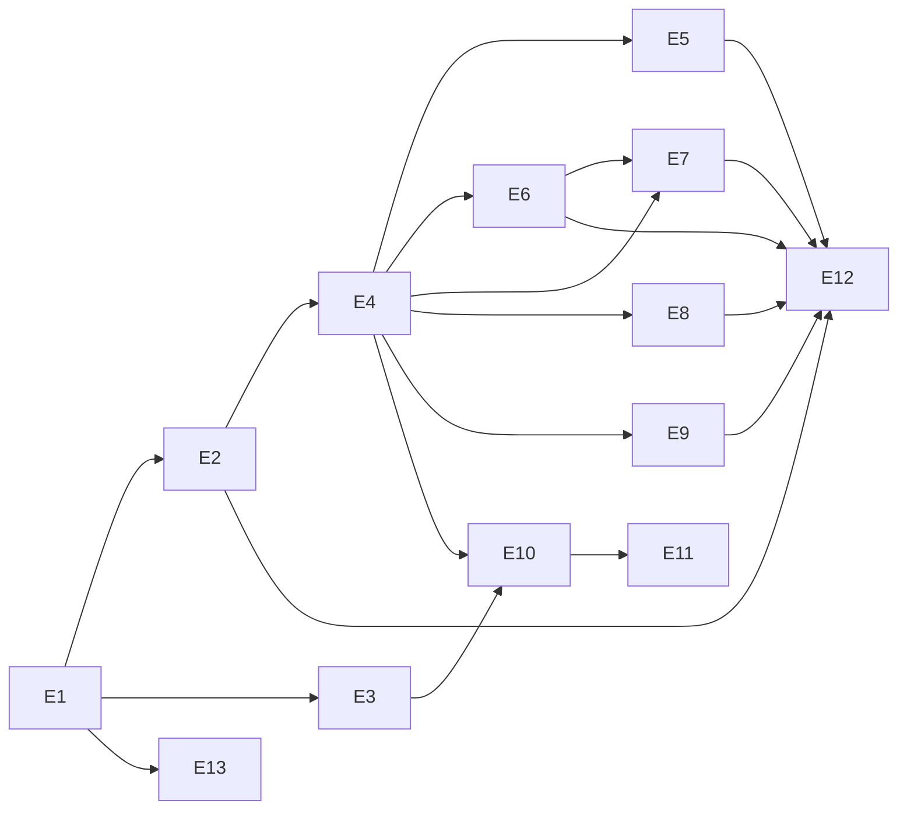

# Roadmap — Epics and Phases

Epics are GitHub issues labeled `epic`; each has sub-issues. Phases are labels `phase:1` … `phase:4`. Issue numbers: epics are #1–#13 (E1 = #1 … E13 = #13); their sub-issues are #14–#95.

| Phase | Goal | Epics |
|---|---|---|
| 1 — Foundation | Running skeleton with provenance rules and one real dataset on a map | E1 Platform foundation · E2 Provenance, attribution & licensing · E4 Map & dashboard framework · E6 Deep Submergence dashboard |
| 2 — Datasets | All five required datasets as dashboards | E5 Argo · E7 EPR Megafauna · E8 IFCB · E9 Satellite |
| 3 — People | Logins, sharing, collaboration | E3 Accounts & auth · E10 Shareable links · E11 Collaboration |
| 4 — Polish | Documentation, operations, quality | E12 Documentation & help · E13 Operations & quality |

## Epics

| # | Epic | Summary | Issue · sub-issues |
|---|---|---|---|
| E1 | Platform foundation | Monorepo, FastAPI + Postgres/PostGIS + React/Vite skeleton, docker compose, CI, OpenAPI export | [#1](https://github.com/figuernd/ocean-app/issues/1) · tasks #14–#21 |
| E2 | Provenance, attribution & licensing | Source registry, fetch log, provenance envelope, access dates in UI, no-simulated-data guard, Data Sources page | [#2](https://github.com/figuernd/ocean-app/issues/2) · tasks #22–#28 |
| E3 | Accounts & authentication | Registration, sessions, email verification, password reset, ORCID OAuth, roles | [#3](https://github.com/figuernd/ocean-app/issues/3) · tasks #29–#34 |
| E4 | Map & dashboard framework | MapLibre base map, layer registry, shared time control, dashboard state model, saved dashboards | [#4](https://github.com/figuernd/ocean-app/issues/4) · tasks #35–#41 |
| E5 | Argo Floats dashboard | ERDDAP index ingest, profile map, T/S plots, float tracks, region export | [#5](https://github.com/figuernd/ocean-app/issues/5) · tasks #42–#47 |
| E6 | Deep Submergence (Alvin & Jason) dashboard | NDSF WFS ingest, ops spreadsheets, R2R cruises, dive cards with Sealog/MGDS links | [#6](https://github.com/figuernd/ocean-app/issues/6) · tasks #48–#54 |
| E7 | EPR Megafauna dashboard (BCO-DMO 932975) | ERDDAP ingest, taxa + cropped images, dive pairing, count charts | [#7](https://github.com/figuernd/ocean-app/issues/7) · tasks #55–#60 |
| E8 | IFCB Plankton dashboard | Datasets, time series, bins, ROI image proxy, bin map | [#8](https://github.com/figuernd/ocean-app/issues/8) · tasks #61–#67 |
| E9 | Satellite Ocean Surface dashboard | GIBS WMTS layers with time domains, legends, ERDDAP point series | [#9](https://github.com/figuernd/ocean-app/issues/9) · tasks #68–#73 |
| E10 | Shareable links | URL state, short links (live/snapshot), public viewer, expiry/revocation | [#10](https://github.com/figuernd/ocean-app/issues/10) · tasks #74–#78 |
| E11 | Collaboration | Workspaces & members, realtime presence/state sync, annotations & comments, history, activity feed | [#11](https://github.com/figuernd/ocean-app/issues/11) · tasks #79–#84 |
| E12 | Documentation & help | In-app help, user guide, Data Sources & Citations page, API docs | [#12](https://github.com/figuernd/ocean-app/issues/12) · tasks #85–#89 |
| E13 | Operations & quality | Deployment, scheduled jobs, rate limiting, observability, e2e tests, accessibility | [#13](https://github.com/figuernd/ocean-app/issues/13) · tasks #90–#95 |

## Dependency sketch

